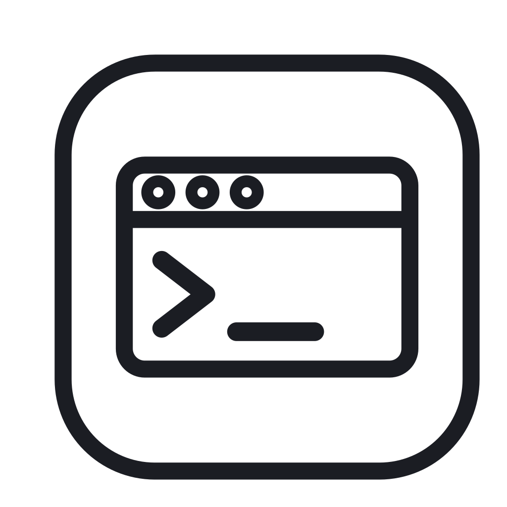

<h1 align="center">
  
  OxideSSH
</h1>

<p align="center">
  A fast, native, memory-safe SSH client for Windows and macOS.
</p>

<p align="center">
  <a href="https://github.com/linko-zhao/OxideSSH/actions/workflows/ci.yml"></a>
  
  
</p>

<p align="center">
  <b>English</b> | <a href="README.zh-CN.md">简体中文</a>
</p>

OxideSSH is a desktop SSH client written in Rust with a native GPU-rendered UI ([GPUI](https://github.com/zed-industries/zed/tree/main/crates/gpui)). It manages saved connection profiles and runs interactive SSH and local shell sessions in tabs, with credentials kept in the operating system's credential store.

## Features

### Connections and credentials
- **Profiles** — name, host, port, username, and authentication method; create, edit, and delete from the workspace.
- **Authentication** — password, private key with optional passphrase, or SSH agent (OpenSSH agent; Pageant fallback on Windows).
- **OS keychain storage** — passwords and passphrases are stored in Windows Credential Manager, macOS Keychain, or the Linux Secret Service. Only an opaque `CredentialRef` is persisted; secrets are never written to disk or logs.
- **Host key verification** — unknown hosts require explicit trust of a SHA-256 fingerprint; a changed host key blocks the connection and must be resolved manually. Trusted hosts are listed and removable in Settings.

### Workspace and tabs
- Searchable host list with colored tags, multi-tag (OR) filtering, an **Untagged** filter, and an **All hosts** view.
- Each SSH connection and each local terminal runs in its own tab; tab strip shows connection state, and closing a tab with a live session asks for confirmation.
- **Local terminal** — a tab running the platform default shell (`$SHELL` or `/bin/sh`; `%COMSPEC%` or `cmd.exe`) in your home directory.

### Terminal
- Alacritty-based terminal emulation with 10,000 lines of scrollback.
- Mouse selection and copy/paste, including bracketed paste (1 MiB paste limit) and Ctrl/Alt/Shift modified keys.
- IME text input, wide characters, and terminal resize propagated to the remote session.
- Color themes (light / dark / follow system) and English / 简体中文 UI.

### Desktop integration
- Custom title bar with integrated tabs and window controls on Windows and macOS; native decorations on Linux.
- macOS: Cmd+Q quit, Dock icon, and “New Window” menu item.
- Conventional `.msi` installer on Windows and `.app` / `.dmg` on macOS.

> Sidebar entries for Keychain, Port forwarding, Snippets, Known Hosts, and Logs are placeholders. Port forwarding and snippets are not implemented yet.

## Platform support

| Platform | Status | Artifact |
| --- | --- | --- |
| Windows x86_64 (MSVC) | Supported | `.msi` installer |
| macOS 14+ (Apple Silicon) | Supported | `.app`, `.dmg` |
| Linux | Development only | Build from source (X11; `scripts/run-linux.sh` targets WSL2/WSLg) |

## Getting started

### Prerequisites
- Rust 1.97.1 (installed automatically via `rust-toolchain.toml`)
- Windows: MSVC build tools
- macOS: Xcode command line tools
- Linux: X11/xkb development libraries and a Secret Service provider (e.g. `gnome-keyring`) for “Remember” credentials

### Build and run

```bash
cargo build -p oxide-ssh-desktop --locked
cargo run -p oxide-ssh-desktop --locked
```

On WSL2/WSLg, use the launcher which stages the missing GUI libraries and starts a keyring daemon:

```bash
./scripts/run-linux.sh
```

The `Makefile` wraps the common tasks:

```bash
make build        # debug build
make release      # release build
make test         # workspace tests
make lint         # rustfmt --check + clippy -D warnings
make package-win  # .msi  (Windows host / CI)
make package-mac  # .app + .dmg (macOS host / CI)
```

## Keyboard shortcuts

`Cmd` on macOS, `Ctrl` on Windows/Linux unless noted.

| Action | macOS | Windows / Linux |
| --- | --- | --- |
| New connection | `Cmd+N` | `Ctrl+N` |
| New local terminal | `Cmd+Shift+N` | `Ctrl+Shift+N` |
| Settings | `Cmd+,` | `Ctrl+,` |
| Close tab | `Cmd+W` | `Ctrl+Shift+W` |
| Copy terminal selection | `Cmd+C` | `Ctrl+Shift+C` |
| Paste into terminal | `Cmd+V` | `Ctrl+Shift+V` |
| Next / previous tab | `Ctrl+Tab` / `Ctrl+Shift+Tab`, or `Cmd+Shift+]` / `Cmd+Shift+[` | `Ctrl+Tab` / `Ctrl+Shift+Tab` |
| Quit | `Cmd+Q` | — |

`Tab` and `Shift+Tab` are sent to the shell; use the shortcuts above to switch tabs.

## Configuration and data

OxideSSH uses the OS project-config directory. Typical locations (the recovery screen shows the exact path):

| Platform | Path |
| --- | --- |
| Windows | `%APPDATA%\linko-zhao\OxideSSH\config\` |
| macOS | `~/Library/Application Support/io.github.linko-zhao.OxideSSH/` |
| Linux | `~/.config/oxidessh/` |

| File | Contents |
| --- | --- |
| `config.json` | Profiles, tags, and app settings |
| `known_hosts.json` | Trusted host keys and SHA-256 fingerprints |

Writes are atomic (temp file + rename). If the storage root is corrupt, OxideSSH starts in a read-only recovery view and never overwrites the damaged files.

## Project layout

| Crate | Responsibility |
| --- | --- |
| `oxide-ssh-core` | Profiles, tags, settings, storage, credentials, host-key trust, and the SSH transport (`russh`) |
| `oxide-ssh-terminal` | Terminal model (`alacritty_terminal`), input encoding, selection, and render snapshots |
| `oxide-ssh-app` | Toolkit-independent tab and session orchestration |
| `oxide-ssh-desktop` | GPUI desktop application: workspace, editor, terminal view, settings, i18n |

## Contributing

```bash
cargo fmt --all
cargo clippy --workspace --all-targets --locked -- -D warnings
cargo test --workspace --all-targets --locked
```

Use [Conventional Commits](https://www.conventionalcommits.org/) for commit messages. `CONTEXT.md` and `GLOSSARY.md` define the project's domain terminology.

## License

MIT — see [LICENSE](LICENSE).
